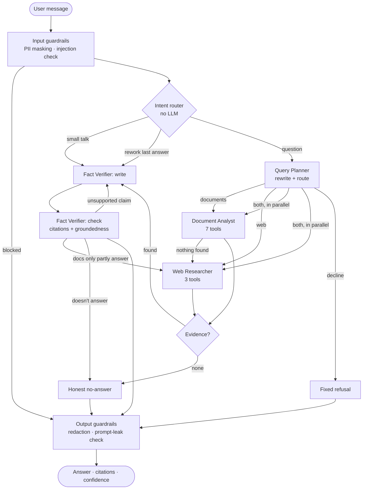

<div align="center">

# Document Intelligence Platform

**A multi-agent RAG assistant that answers from your documents and the web,
cites every claim, fact-checks itself, and says so when it can't find the answer.**

LangGraph · LangChain · Groq (gpt-oss) · Hybrid search · RAGAS · FastAPI · React

</div>

---

## Highlights

- **Feels like a chat app, works like a research team.** Small talk gets an instant
  reply. Real questions go to four agents: they plan the search, research your
  documents and the web in parallel, write a cited answer, and verify it.
- **Citations open the real document.** Click a source and the PDF opens beside the
  chat on the cited page, with the passage marked in highlighter. Open any file from
  the library to see its details (type, pages, indexed passages, size) and ask about it.
- **Follow-ups without re-searching.** *"Make it shorter"*, *"translate that to Hindi"*
  or *"as a table"* reshapes the last answer from the same sources, with the same
  citation numbers. It takes about 3 seconds and the rewrite is still fact-checked.
- **Web search that reads pages.** Several search engines are queried in parallel,
  merged with RRF and re-ranked with a cross-encoder. The top pages are read in full
  and reduced to their most relevant passages.
- **Hybrid retrieval over your files.** BM25 + dense vectors + Reciprocal Rank Fusion
  + cross-encoder re-ranking. MRR rises from **0.552 to 0.797** compared with
  vectors alone.
- **Honest by design.** When nothing reliable exists, the answer is a deterministic
  "couldn't find it" that shows what was searched. No LLM writes it, so there's
  nothing to hallucinate.
- **Guardrails at every layer.** PII masking, prompt-injection blocking (heuristics +
  Llama Prompt Guard 2), cleaning of instruction-like text out of retrieved
  passages, output redaction, prompt-leak detection, and rate limiting.
- **Measured.** RAGAS faithfulness **0.95**, plus 100% correct abstention and
  100% blocking of adversarial prompts on the golden set.

## How it works



| Agent | Role |
|---|---|
| **Query Planner** | Rewrites the question so it stands alone, then routes it to documents, web, both, or a direct reply (or declines it). Uses one structured LLM call, not a free-form loop. |
| **Document Analyst** | A ReAct agent over your library: hybrid search, page-by-page reading for whole-document questions, neighbouring passages, summaries, comparisons, a calculator. |
| **Web Researcher** | First runs an *anchor* search in the user's own words, then searches further if needed. |
| **Fact Verifier** | Writes the answer, checks every citation and claim, and revises once. If the documents miss part of the question, it sends the Web Researcher after the gap. |

All agents write evidence into one per-turn **citation registry**, so `[n]` numbers stay
consistent even when agents run in parallel. The whole turn streams to the UI over
Server-Sent Events.

<details>
<summary><b>The 13 tools</b></summary>

| Agent | Tool | Purpose |
|---|---|---|
| Planner | `list_documents` | what's in the library |
| Document Analyst | `search_documents` | hybrid search across all documents |
| | `read_whole_document` | best passage of every page, in order — for "list all…" and "explain this document" |
| | `search_within_document` | hybrid search inside one document |
| | `get_adjacent_chunks` | read the text around a passage |
| | `summarize_document` | summary of a whole document |
| | `compare_documents` | evidence from two documents side by side |
| | `calculator` | exact arithmetic (AST-whitelisted, no `eval`) |
| Web Researcher | `web_search` | parallel metasearch → RRF → re-rank → read top pages |
| | `fetch_webpage` | read one page (SSRF-guarded) |
| | `wikipedia_lookup` | definitions and background |
| Fact Verifier | `verify_citations` | deterministic: invented `[n]`, uncited claims |
| | `check_groundedness` | LLM judge: support, coverage, missing parts |

</details>

<details>
<summary><b>What makes it robust</b></summary>

- **Intent router before any LLM call**: a word list for pleasantries, then
  embedding similarity to labelled examples, with a confidence threshold and a
  margin. Anything ambiguous goes to the planner.
- **Model failures**: retries with backoff, fallback to the other model tier, and
  quotes straight from the sources if every model is down.
- **Search failures**: hedged requests across engines, a circuit breaker for engines
  that keep failing, Wikipedia as a supplement, a 15-minute cache, and separate
  messages for "no results" and "web unreachable".
- **Stale model knowledge**: today's date goes into every prompt, the first search
  uses the user's own words, and the writer trusts recent sources over memory.
- **Tool crashes and step limits** become messages the agent can react to; each
  turn has a hard deadline.

</details>

## Results

<!-- RESULTS:START -->
**End-to-end evaluation** (`evals/ragas_eval.py`): a 20-question golden set, run live on
Groq. The RAGAS judge is `qwen/qwen3.8-27b`, a different model family from the
system under test. Full report: [evals/results/RAGAS_REPORT.md](evals/results/RAGAS_REPORT.md).

| RAGAS (12 answerable questions) | Score |
|---|---|
| Faithfulness | **0.952** |
| Answer relevancy | **0.912** |
| Context precision | **0.894** |
| Context recall | **0.958** |

| Behaviour | Result |
|---|---|
| Answerable questions answered with citations, verified "high" | **100%** (12/12) |
| Unanswerable questions → honest "couldn't find it" | **100%** (4/4) |
| Prompt injections blocked / harmful requests declined | **100%** (4/4) |
| Answers that needed a self-correction revision | 25% |
| Latency p50 (free-tier Groq, including verification) | 34 s |
<!-- RESULTS:END -->

**Retrieval benchmark** (`evals/retrieval_benchmark.py`, 16 labelled queries, no LLM):

| Mode | Hit@1 | Hit@4 | MRR | Exact-ID queries |
|---|---|---|---|---|
| Dense only | 37.5% | 75.0% | 0.552 | 75% |
| BM25 only | 68.8% | 81.2% | 0.734 | 100% |
| Hybrid (RRF) | 68.8% | 87.5% | 0.781 | 100% |
| **Hybrid + re-rank** | **75.0%** | **87.5%** | **0.797** | **100%** |

The evaluation corpus is a small fictional product ("Aurora", in `data/sample_docs`), so
these numbers are a regression baseline for this project, not a general benchmark.

## Quickstart

**You need:** Python 3.12 with [uv](https://docs.astral.sh/uv/), Node 20+, and a free
[Groq API key](https://console.groq.com/keys).

```bash
cp .env.example .env          # set GROQ_API_KEY
uv sync
uv run uvicorn rag_agent.api:app --reload --port 8000

cd frontend && npm install && npm run dev     # open http://localhost:5173
```

The local embedding and re-ranker models download once on first start (~150 MB).
Then upload your PDFs, text or Markdown files and start asking.

- **Sample documents:** with `SEED_SAMPLE_DOCS=true`, the Aurora sample library is
  indexed at startup so you can try the app immediately.
- **Optional keys:** `TAVILY_API_KEY` makes web search more reliable, because the
  keyless engines rate-limit busy IPs. `LANGSMITH_API_KEY` adds tracing and
  thumbs-up/down feedback.
- **Docker:** `docker compose up --build` serves the UI on http://localhost:8080 and
  the API on :8000.

Every setting is documented in [.env.example](.env.example).

## Tests and evaluation

```bash
uv run pytest                                  # 200+ tests, offline, no API key
uv run python -m evals.retrieval_benchmark     # compares retrieval modes, no LLM
uv run python -m evals.ragas_eval              # RAGAS + behaviour report (uses Groq)
```

The agent tests drive the real LangGraph graph with scripted fake models. Routing,
parallel agents, revision loops, follow-up reworks, web-search fallbacks and every
failure path are therefore tested deterministically.

## Project layout

```
src/rag_agent/
  agents/        graph · intent router · planner · researchers · verifier · no_answer · guard
  tools/         documents · web · verification            (the 13 tools)
  retrieval/     bm25 · fusion (RRF) · rerank · hybrid
  guardrails/    pii · injection · sanitize · output · rate_limit
  websearch.py   hedged metasearch · fusion · re-rank · page reading · cache
  api.py         FastAPI + SSE           streaming.py   graph events → SSE
  llms.py        Groq models, per-role tiers, fallbacks
evals/           golden set · RAGAS · retrieval benchmark
frontend/src/    React UI: chat, research trace, citation cards, sources, library
tests/           offline test suite
```

**[GUIDE.md](GUIDE.md)** is the full study guide. It covers how a request flows through
the system, every module, the design decisions and trade-offs, and interview
questions.

## Acknowledgements

Built on an MIT-licensed agentic RAG starter by Sainath S Borule (see
[LICENSE](LICENSE)). It was then extended with the Groq migration, hybrid retrieval,
the multi-agent system, intent routing, the web search pipeline, failure handling,
guardrails, and RAGAS evaluation.
